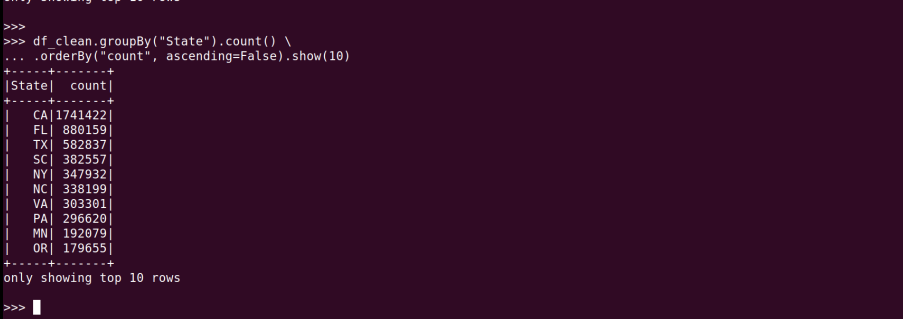
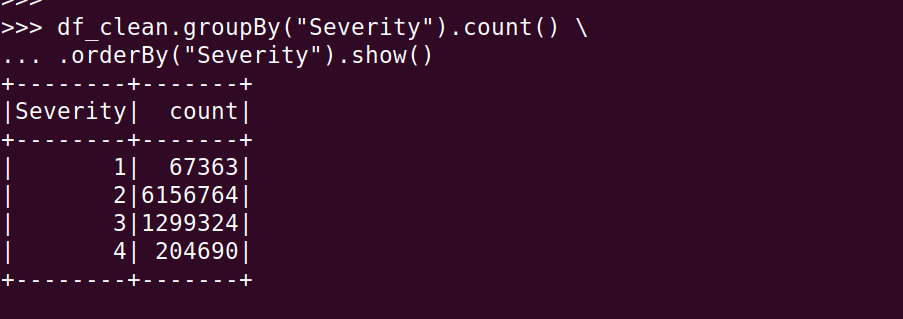
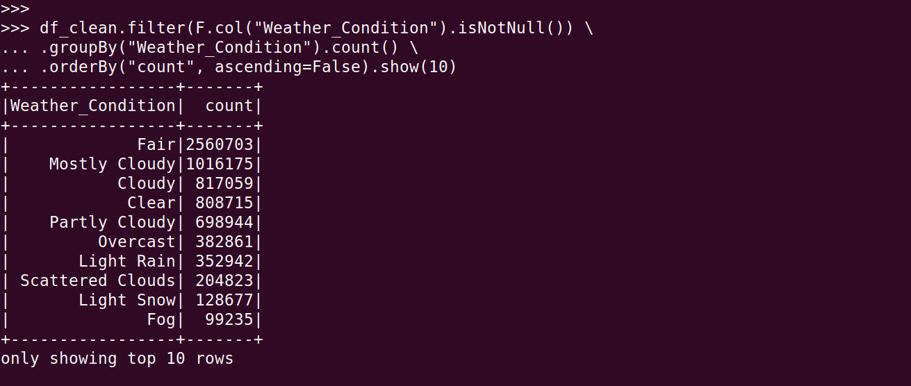
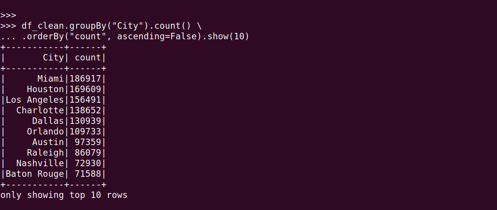
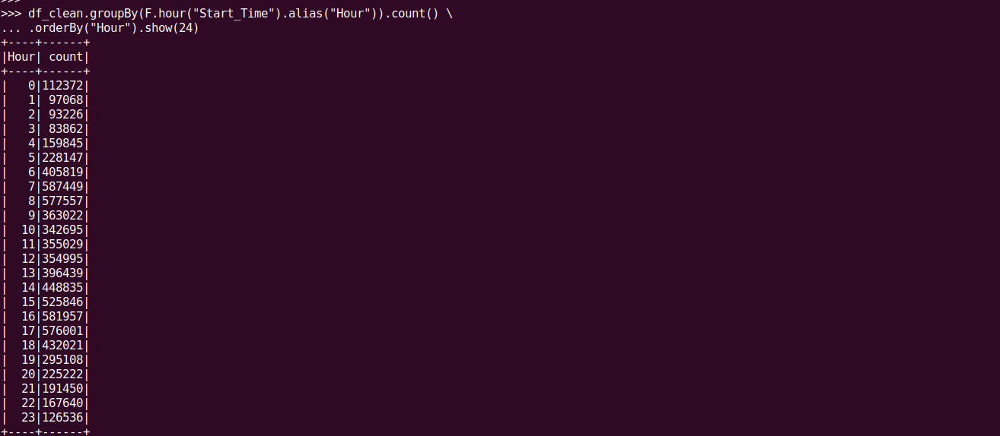
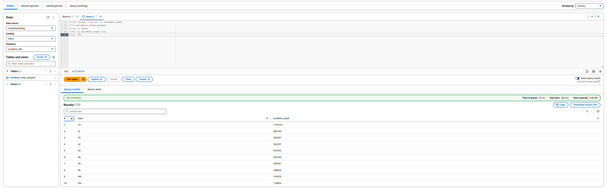
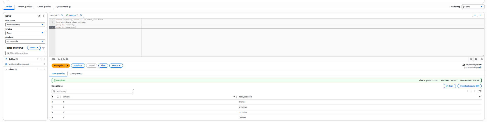
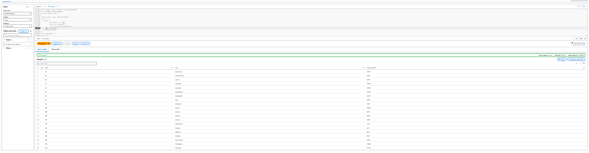

# Cloud Data Pipeline Using AWS and Apache Spark

## 1. Project Overview
This project demonstrates an end-to-end cloud data pipeline built with AWS and Apache Spark to process and analyze the US Accidents dataset.

The raw data is stored in Amazon S3, processed with PySpark on Amazon EMR, written back to S3 as Parquet, cataloged with AWS Glue, and queried with Amazon Athena.

## 2. Problem Statement
The US Accidents dataset contains millions of records with details such as accident severity, location, start time, temperature, and weather conditions.

The objective is to build a cloud-based pipeline that can:

- Store raw data in Amazon S3.
- Process large-scale data using PySpark on Amazon EMR.
- Select the required columns, cast them to proper types, and remove records with null values in the core columns.
- Analyze accident records by state, severity, weather, city, and hour.
- Store processed data in Parquet format, partitioned by state where applicable.
- Use AWS Glue to catalog the processed data.
- Run SQL analysis using Amazon Athena.

## 3. Dataset

**Dataset:** US Accidents (March 2023 version)
**Local path:** `data_sets/accidents_data/US_Accidents_March23.csv`
**Approximate size:** 2.8 GB
**Approximate records:** 7.7 million

Columns used in the project:

- `ID`
- `Severity`
- `Start_Time`
- `City`
- `State`
- `Temperature(F)` (renamed to `Temperature_F` in the processed data)
- `Weather_Condition`

> **Note:** The CSV file is not included in this repository due to its size (2.8 GB).

## 4. Technologies Used

- Python
- Apache Spark / PySpark
- Amazon S3
- Amazon EMR
- AWS Glue Crawler and Data Catalog
- Amazon Athena
- Parquet
- Linux (Ubuntu)

## 5. Pipeline Architecture

```text
US Accidents CSV
       |
       v
Amazon S3 (Raw Data)
       |
       v
Amazon EMR + PySpark
(cleaning + analysis)
       |
       v
Amazon S3 (Parquet Output)
 - accidents_clean_parquet/   (partitioned by State)
 - emr_state_wise_parquet/    (state-wise counts)
       |
       v
AWS Glue Crawler
       |
       v
Glue Data Catalog
       |
       v
Amazon Athena (SQL Analysis)
```

## 6. Implementation

### Step 1: Upload the Raw Dataset to S3
Upload the dataset to the configured S3 bucket:

```text
s3://aaqib-data-pipeline-bucket/data_sets/accidents_data/US_Accidents_March23.csv
```

### Step 2: Process Data Using Amazon EMR
Run the PySpark job:

```text
scripts/emr_etl_job.py
```

The job reads the CSV file from S3 (without `inferSchema`, so the file is scanned only once) and selects the required columns. It then casts them to proper types:

- `Severity` → integer
- `Start_Time` → timestamp
- `Temperature(F)` → double, renamed to `Temperature_F` to avoid special characters in column names

Records with null values in the core columns (`ID`, `Severity`, `Start_Time`, `State`, `City`) are removed. The row count is printed before and after cleaning to verify how many records were dropped.

The job then performs the following analyses:

- State-wise accident count
- Severity-wise accident count
- Weather-condition analysis
- City-wise analysis
- Hour-wise analysis

The cleaned DataFrame is persisted (`MEMORY_AND_DISK`) so it is not recomputed for every analysis.

Outputs written to S3:

- Cleaned data in Parquet format, partitioned by `State` (with `repartition("State")` applied before writing):

  ```text
  s3://aaqib-data-pipeline-bucket/output/accidents_clean_parquet/
  ```

- State-wise accident counts as a single Parquet file (not partitioned, since the data is small):

  ```text
  s3://aaqib-data-pipeline-bucket/output/emr_state_wise_parquet/
  ```

### Step 3: Catalog Data with AWS Glue
Run an AWS Glue Crawler on the cleaned data output location to create or update the table in the Glue Data Catalog:

```text
s3://aaqib-data-pipeline-bucket/output/accidents_clean_parquet/
```

The crawler registers the `State=...` partition folders automatically.

### Step 4: Query Data with Amazon Athena
Run the SQL queries against the cataloged table `accidents_clean_parquet` using:

```text
queries/accident_analysis_queries.sql
```

Run the queries one at a time in the Athena query editor.

## 7. Analysis Performed

### State-wise Accident Analysis
Counts accident records by state and identifies the states with the highest number of records.



### Severity Analysis
Counts accident records for each severity level.



### Weather-condition Analysis
Analyzes accident records by weather condition (records with null weather are excluded from this analysis).



### City-wise Analysis
Identifies the cities with the highest number of accident records.



### Hourly Analysis
Analyzes accident activity using the hour extracted from `Start_Time`.



### DataFrame Preview


### Athena Queries
The SQL query file includes:

- Top 10 states with the most accidents
- 


- Accidents by severity


  
- Top 10 weather conditions with the most accidents  ([View](docs/screenshots/athena/04_top10_cities_california.png))
- Top 10 cities with the most accidents in California (`State = 'CA'`, which also reads only the `State=CA` partition to reduce data scanned)
- Accidents per hour (0 to 23)
- Top 10 accident counts per minute (using a subquery)
- Month-wise accident counts
- Top 5 states with the highest average severity (states with fewer than 1,000 records excluded)
- Top 3 cities per state (using CTE and window function)



## 8. Project Structure

```text
.
├── data_sets/
│   └── accidents_data/
│       └── US_Accidents_March23.csv   (not included in repo due to size)
├── docs/
│   ├── project_documentation.md
│   └── screenshots/
│       ├── athena/
│       ├── emr/
│       │   ├── execution/
│       │   └── setup/
│       ├── glue/
│       └── s3/
├── output/
│   ├── accidents_clean_parquet/
│   ├── emr_state_wise_parquet/
│   └── athena_results/
├── queries/
│   └── accident_analysis_queries.sql
├── scripts/
│   └── emr_etl_job.py
└── README.md
```

The `output/` folders contain local copies of the outputs. `accidents_clean_parquet/` and `emr_state_wise_parquet/` are Spark outputs, while `athena_results/` holds Athena query results. Generated part-file names can vary between runs, so they are not listed individually.

The raw CSV (`data_sets/`) is excluded from the repository via `.gitignore` because of its size.

## 9. Outputs and Screenshots
Local output folders documented in this repository:

```text
output/accidents_clean_parquet/   -> cleaned data, partitioned by State
output/emr_state_wise_parquet/    -> state-wise accident counts
output/athena_results/            -> Athena query results
```

The same Parquet outputs are written to Amazon S3. Screenshots documenting the AWS workflow are stored under:

```text
docs/screenshots/
```

They cover S3, EMR setup and execution, Glue crawler/cataloging, and Athena query results.

## 10. Challenges and Learning

### Challenges

- Processing a large CSV dataset (about 2.9 GB) with Spark.
- Reading raw data directly from Amazon S3.
- Avoiding a slow extra pass over the file: `inferSchema` was removed and only the required columns were cast to proper types.
- Cleaning records without losing too much data: using `dropna` on all columns removed many valid records, so it was limited to the core columns with `subset`. Row counts before and after cleaning are printed to verify the data loss.
- Avoiding repeated recomputation, since the same DataFrame is used for many analyses (solved with `persist`).
- Avoiding many small files when writing partitioned data: `repartition("State")` is used before `partitionBy("State")`, so each state's data is grouped together and the output has far fewer files.
- Writing the small state-wise summary without creating many tiny files (solved by removing `partitionBy` and using `coalesce(1)`).
- Cataloging partitioned S3 data using AWS Glue.
- Querying the cataloged data using Amazon Athena.

### Key Learnings

- Building an AWS-based data pipeline.
- Using Amazon S3 for raw and processed data.
- Processing large datasets with PySpark on Amazon EMR.
- Why `inferSchema` is slow on large files and how to cast columns explicitly.
- Handling nulls with `dropna(subset=[...])`.
- Using `persist` / `cache` for better performance.
- Difference between `repartition` and `coalesce`, and when to use each.
- Writing Parquet data and partitioning by state, and how partition filters reduce Athena scan cost.
- Using AWS Glue Crawlers and the Data Catalog.
- Running SQL analysis in Athena, including CTEs and window functions (`ROW_NUMBER`).

## 11. My Contribution
I worked on the complete project workflow: uploading the raw dataset to S3, processing it with PySpark on EMR, selecting and casting the required columns, removing records with nulls in the core columns, performing the accident analysis, writing partitioned Parquet outputs, using AWS Glue Crawler and Data Catalog for cataloging, and preparing the Athena SQL queries.

## 12. How to Run
1. **Upload the raw CSV** to the S3 location configured for the project.
2. **Submit the Spark job** on an EMR cluster:

   ```bash
   spark-submit scripts/emr_etl_job.py
   ```

3. **Run the Glue Crawler** on `s3://aaqib-data-pipeline-bucket/output/accidents_clean_parquet/` to create or update the Data Catalog table.
4. **Execute the SQL statements** in `queries/accident_analysis_queries.sql` in Athena, one query at a time, after confirming the database and table name.
5. **Terminate the EMR cluster** when the job is done to avoid extra charges.

## 13. Conclusion
This project demonstrates a cloud data pipeline for processing and analyzing the US Accidents dataset with PySpark and AWS services. It covers raw-data storage in S3, distributed processing with EMR, Parquet outputs, Glue-based cataloging, and SQL analysis in Athena.
